# ORBIT

**A pocket music maker for the [Waveshare ESP32-C6 Touch-LCD-1.83](https://www.waveshare.com/esp32-c6-touch-lcd-1.83.htm) (~$20 on AliExpress etc).**

<a href="https://www.waveshare.com/esp32-c6-touch-lcd-1.83.htm">
  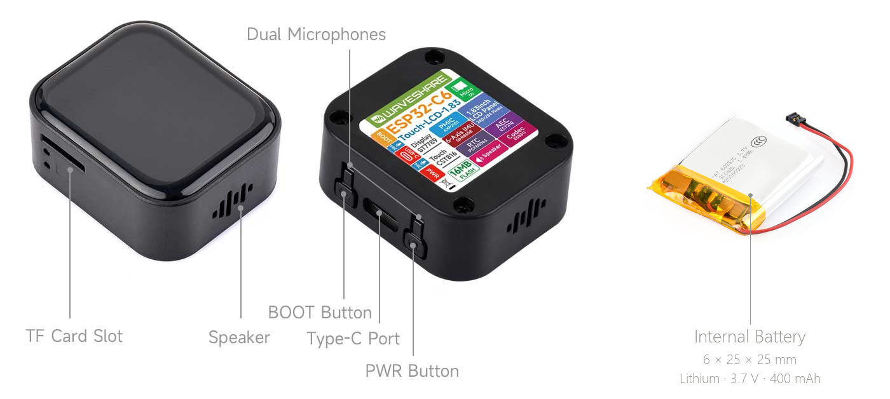
</a>

*Device photo: [Waveshare](https://www.waveshare.com/esp32-c6-touch-lcd-1.83.htm).*

Make a beat, add a bassline, play an instrument, and turn your voice into music.
ORBIT is a standalone, beginner-friendly instrument: no computer, account, network,
or music theory is needed once it is installed.

| Play music | Find your way around |
|---|---|
| 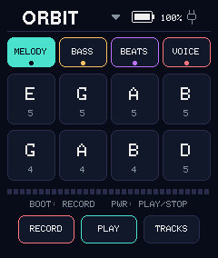 | 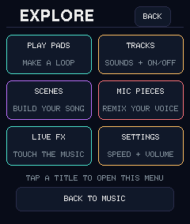 |

Screenshots are captured from the firmware's actual 240 x 284 rendering on the
device, not design mockups.

## What it can do

- **Four looping tracks:** MELODY, BASS, BEATS and VOICE, playing together over two bars.
- **30 sounds:** 21 sampled instruments and nine electronic sounds, including
  acoustic and electric guitars, piano, strings, flute, saxophone, trumpet and tuba.
- **Simple playing:** tap for a short, tempo-matched hit; hold for a longer note.
  The eight pads stay in your chosen key and mood.
- **Record, layer and undo:** get-ready and practice countdowns, fresh takes or overdubbing,
  sixteenth-note timing, and up to 96 notes on each track.
- **Four scenes:** INTRO, GROOVE, BREAK and DROP, each with its own arrangement.
- **Microphone sampling:** record up to two seconds, play it at different pitches,
  or divide it into eight playable pieces.
- **Live effects:** finger-controlled filtering and echo, with recordable movements.
- **12 original demos:** acoustic pop, jazz, cinematic, brass band, club,
  heavy guitar and bright retro dance styles.
- **Automatic saving, battery indication and screen sleep.**

## Install ORBIT

### Hardware

You need:

- A **Waveshare ESP32-C6 Touch-LCD-1.83**, with **16 MB flash** and its compatible
  speaker connected. This is the tested board, not a generic ESP32 development board.
- A **USB data cable** and a computer for installation.
- Optionally, a battery compatible with the board. Follow
  [Waveshare's hardware and battery guidance](https://www.waveshare.com/wiki/ESP32-C6-Touch-LCD-1.83).

The touchscreen, microphone, audio codecs and buttons use the board's existing
connections; no additional wiring is needed. The screen runs in portrait at
240 x 284 pixels.

### Set up the software

The build is verified on Windows with Python 3.11 and Arduino CLI 1.3.1.
The helper resolves paths from Arduino CLI, rather than requiring a particular
username or Arduino installation directory. Other desktop platforms have not yet
been verified.

1. Install [Python 3.11 or newer](https://www.python.org/downloads/) and
   [Arduino CLI](https://arduino.github.io/arduino-cli/latest/installation/).
   An existing Arduino IDE installation's CLI can also be used.
2. Clone this repository and install the small build dependency:

   ```sh
   git clone https://github.com/PaulMaddox/orbit-synth.git
   cd orbit-synth
   python -m pip install -r requirements.txt
   ```

   On Windows, use `py` in place of `python` if necessary. A Python virtual
   environment is recommended; it is not committed to the repository.

3. Install the tested core and library versions:

   ```sh
   arduino-cli config add board_manager.additional_urls https://espressif.github.io/arduino-esp32/package_esp32_index.json
   arduino-cli core update-index
   arduino-cli core install esp32:esp32@3.3.2
   arduino-cli lib install "GFX Library for Arduino@1.6.3" "XPowersLib@0.3.0"
   ```

4. Connect the board and find its serial port:

   ```sh
   python -m serial.tools.list_ports
   python build.py --check
   ```

   The examples below use `COM3`. Replace it with your board's port.
   Close any serial monitor before flashing.

### First installation

> **Installing replaces the board's firmware and partition layout. Existing
> firmware data may be lost.** Use this command for a new board or when replacing
> unrelated firmware, not for routine ORBIT updates.

```sh
python build.py --install COM3
```

This builds the checked-in sounds and firmware, checks the application fits, then
flashes the bootloader, partition table, boot support and application. It does not
need to download or regenerate instrument recordings.

The board restarts into ORBIT. Press **PLAY** to hear the starter demo.
Start with a low volume; the default is 35%.

If Arduino CLI is not on your path, supply its existing executable:

```powershell
py build.py --cli "C:\Program Files\Arduino IDE\resources\app\lib\backend\resources\arduino-cli.exe" --install COM3
```

`ARDUINO_CLI` is also supported. Use an approved installation if your computer
restricts executables; do not disable security controls.

### Updating an existing ORBIT installation

```sh
python build.py --flash COM3
```

This writes **only the application** at `0x10000`, leaving the existing ORBIT
partitions and filesystem in place. Do not use a merged full-flash image for a
routine update. To build without touching the device, run `python build.py`.

## Your first loop

| Get ready: two loops | Practice: two loops |
|---|---|
| 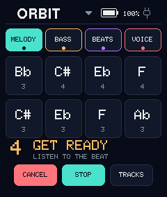 | 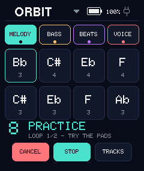 |

1. Tap **MELODY**, **BASS**, **BEATS** or **VOICE** to choose a track.
2. Tap **RECORD**, or briefly press **BOOT**.
3. Choose **START FRESH** to replace that track, or **KEEP + ADD NOTES** to layer
   more notes. START FRESH is selected after three seconds if you do not choose.
4. Follow **GET READY**, then **PRACTICE**. Each stage lasts **two full loops**:
   **8→1, then 8→1 again**, at your selected tempo. Listen to the beat during
   GET READY; try your part on the pads during PRACTICE. Nothing is recorded yet.
5. When **RECORDING** appears, play your part. It repeats over **two bars**.
6. Tap **FINISH** to stop adding notes while the loop keeps playing.
7. Choose another track and add another part.

The screen shows the stage, a large beat countdown and **LOOP 1/2** or **LOOP 2/2**.
Each stage is 16 beats; at 120 BPM the complete preparation takes 16 seconds.
Existing backing tracks join in during PRACTICE. With START FRESH, the selected
track's old part is silent during practice but is only replaced when recording
actually begins.

When music is already playing, preparation starts at the next loop boundary.
**CANCEL** leaves your notes unchanged and restores the previous playback state;
**STOP** stops everything. A new take automatically turns its selected track on.

Hold **BOOT** to undo or redo the last track recording or clear. Starting fresh
does not erase the other tracks, and undo can bring the previous take back.

### Tap or hold: no mode switch

On MELODY and BASS, a quick tap plays an **eighth note**:

| Tempo | Tap length |
|---|---|
| 60 BPM | 500 ms |
| 120 BPM | 250 ms |
| 180 BPM | About 167 ms |

Keep your finger down for a longer note, then lift to stop it. Plucked instruments
still decay naturally; a held guitar is not an endless organ. Recordings remember
your short taps and longer holds, and stay in time when you change the tempo.

BEATS and VOICE work differently: each tap lets the drum hit, recording, or mic
piece finish naturally. Echo can deliberately continue after a note ends.

## Tracks and sounds

| Mix the four tracks | Choose an instrument |
|---|---|
| 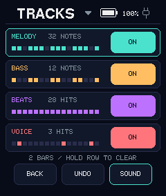 | 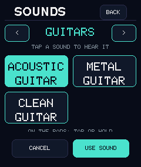 |

Tap the page title and arrow at the top left to open **EXPLORE**, then **TRACKS**.
Select a row to choose a track, and tap **ON/OFF** to mute or unmute its loop.
Hold a row to clear it, with confirmation. Undo can restore it.

For MELODY or BASS, open **SOUND > CHOOSE SOUND**. Use **< / >** to browse
families, tap a card to hear it, then **USE SOUND**. CANCEL or BACK keeps the
original choice. **LISTEN** on the sound page previews the current sound.

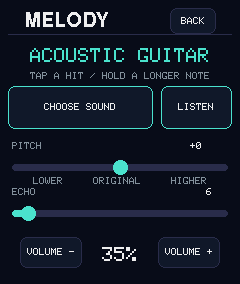

| Family | Sounds |
|---|---|
| Guitars | Acoustic Guitar, Metal Guitar, Clean Guitar |
| Keys | Glock, Marimba, Piano, Organ |
| Strings | Harp, Cello, Strings, Solo Violin |
| Winds | Saxophone, Flute, Clarinet, Oboe |
| Brass | Trumpet, French Horn, Trombone, **Tuba** |
| Bass | Bowed Bass, Deep Bass, Pluck Bass, Growl Bass |
| Electro | Acid, Saw Stack, Pulse Lead, Game Bass |
| Pads | Warm Pad, Dream Pad, Vox Pad |

Recorded instruments use sensible natural registers: very low flute notes, for
example, move by octaves into the flute's range without changing the musical key.
Electronic sounds remain freely transposable.

**PITCH** moves a track up or down one octave; the middle marker is the original
pitch. **ECHO** adds repeating echoes. Drum pitch changes the drum bodies; voice
pitch changes playback speed and length. Master volume has an 80% software limit.

## Scenes: turn a loop into a song

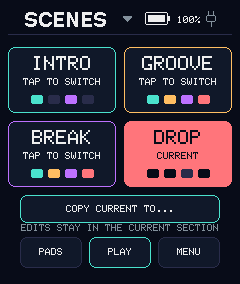

Open **EXPLORE > SCENES** and choose **INTRO**, **GROOVE**, **BREAK** or **DROP**.
During playback, the switch waits for the end of the current two-bar loop.
**NEXT LOOP** shows the queued section. Tap it again, or tap the current section,
to cancel. While stopped, switching is immediate.

Each section remembers its notes, instruments, pitches, on/off states, echoes,
voice-piece setting and recorded effects. Changes are remembered automatically.
Tempo, key, mood, master volume and the original microphone recording are shared.

Use **COPY CURRENT TO...**, choose a destination, and confirm **COPY HERE** to
make a variation. This replaces the destination section, not the current one.
Finish recording notes or effects before switching or copying.

Demos have deliberately arranged sections with different patterns and instruments,
not just muted tracks. Newly created starter sections are simpler variations.

## Record your voice, then play it

| Record a sound | Play eight pieces |
|---|---|
| 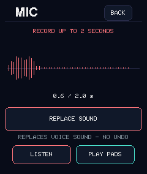 | 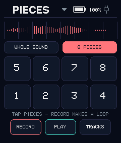 |

Choose **VOICE**, then open **SOUND > RECORD SOUND**. An empty voice track opens
the recorder automatically. Record up to **two seconds**, or tap
**FINISH RECORDING** earlier. The speaker is muted during capture to avoid feedback.

**LISTEN** plays the recording. **PLAY PADS** returns to pitched pads:
tap different notes to play the same sound higher or lower.
Record a loop just as you would with an instrument track.

For rhythmic chops, open **EXPLORE > MIC PIECES** or **VOICE > SOUND > 8 PIECES**.
The waveform is split into **eight equal-time pieces**. Tap or slide over the
numbered pads, then record your performance into the VOICE track.

**WHOLE SOUND** returns to ordinary pitched playback. Pieces do not cut up or
overwrite the original recording, and existing piece notes remember their pieces.
Replacing the original sound changes voice playback in **every scene** and cannot
be undone, so listen before replacing it.

## Live FX: shape the music with a finger

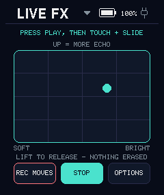

Open **EXPLORE > LIVE FX**, press **PLAY**, then touch the big pad:

- **Left:** softer and darker. **Right:** brighter.
- **Up:** more repeating echo.
- **Lift:** remove your temporary effect without erasing any music.

**REC MOVES** uses the same two-loop GET READY and two-loop PRACTICE stages,
then records movement over one two-bar loop. Practice touches are heard but not
saved. When already playing, preparation starts at the next loop boundary.
Recording finishes automatically, or **FINISH** keeps a shorter pass.

**OPTIONS** lets you turn recorded moves on/off, undo/redo, or clear them.
Recording new moves replaces that section's previous movement; confirmation and
undo are available. Live touching temporarily overrides recorded moves.
Record notes and effects in separate passes.

## Tempo, key, mood and demos

| Session settings | Original demo songs |
|---|---|
| 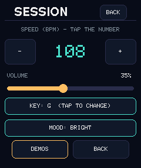 | 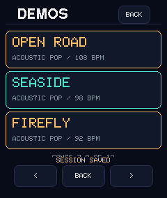 |

Tap the top-right battery/status area to open **SESSION**.
Use **SPEED (BPM)** +/-, or tap the number in time with your beat.
**KEY** changes the root note. **MOOD** chooses notes that work together:
BRIGHT is major pentatonic, DREAMY is minor pentatonic, and MOODY is natural minor.

Open **DEMOS**, browse with **< / >**, choose a song, and confirm **LOAD DEMO**.
There are three large cards on each of four pages.

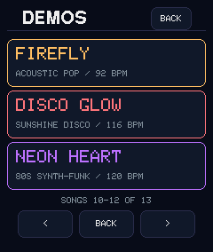

| Demo | BPM | Style |
|---|---:|---|
| Sunlit | 100 | Acoustic pop |
| Velvet | 112 | Swung jazz |
| Stardust | 86 | Cinematic |
| Tuba Parade | 116 | Brass band, including tuba bass and a tuba melody |
| Neon | 126 | Electronic club |
| Iron | 138 | Heavy guitar |
| Open Road | 108 | Driving acoustic pop |
| Seaside | 98 | Syncopated acoustic pop |
| Firefly | 92 | Gentle piano, guitar and harp pop |
| Disco Glow | 116 | Sunshine disco |
| Neon Heart | 120 | Synth-funk |
| Saturday | 118 | Retro dance-pop |

Each includes all four tracks, four arranged scenes and its own expressive vocal
phrase. These are **original compositions**, not covers.

> Loading a demo replaces the current loops, scenes, sound choices, key, tempo and
> microphone sample. Master volume is kept. Browsing or cancelling changes none
> of that music, and a loaded demo waits for you to press PLAY.

## Buttons, saving and power

| Control | Action |
|---|---|
| BOOT, short press | Record / finish recording; opens the fresh-or-add choice |
| BOOT, hold | Undo / redo the last track take or clear |
| PWR, short press | Play / stop |
| PWR, long press | Board's hardware power-off |
| Touch or button while asleep | Wake only; that first gesture does not play or record |

Do not hold BOOT while powering on unless you intend to enter the ESP32 downloader.

ORBIT saves your session automatically after stopping and leaving the controls
idle. Wait for **SESSION SAVED** before powering off. The last session returns on
the next boot; there is no separate Save button.

The screen sleeps after **60 seconds** of stopped inactivity. Playing, recording
and microphone capture keep it awake. Sleep reduces battery use while keeping
your session ready. Touch the screen or press a button to wake it; that first
gesture only wakes the device. Battery and USB indicators reflect actual hardware readings;
USB-only operation does not invent a battery percentage.

## Troubleshooting

| Problem | Try |
|---|---|
| No serial port | Use a USB **data** cable, reconnect, close other serial tools and check the port list again. |
| Flash cannot connect | Check the port; if needed, use the board's BOOT/reset procedure, then release BOOT after upload. |
| Silent music | Check master volume, the speaker connection, track ON/OFF and PLAY. VOICE needs a recording. |
| A plucked sound will not sustain forever | This is intentional: guitar, piano and other plucked sounds decay naturally. |
| Recording seems delayed | GET READY and PRACTICE each run for two full loops. Recording starts afterward; already-playing music first waits for a loop boundary. |
| Voice is too short | Capture closer to the microphone and use FINISH RECORDING only after the sound. Maximum capture is two seconds. |
| CAPTURE GLITCH | Stop playback, retry capture, and check USB power. |
| Screen is dark | Touch once to wake. Check USB/battery power if it stays dark. |
| Build dependencies do not match | Run `python build.py --check` and install the exact versions listed above. |

For serial diagnostics, sound-bank regeneration and feature development, see
[AGENTS.md](AGENTS.md). Audio and artwork provenance is documented in
[THIRD_PARTY_NOTICES.md](THIRD_PARTY_NOTICES.md) and
[assets/ATTRIBUTION.txt](assets/ATTRIBUTION.txt).
